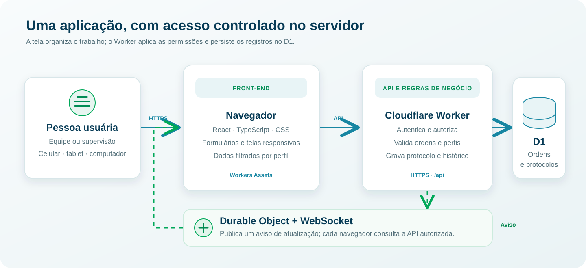

<div class="doc-cover technical-cover">
  <span class="cover-kicker">CONTROLE DE EXECUÇÃO DE ORDENS</span>
  <h1>Documentação do sistema</h1>
  <p>Produto, arquitetura, regras operacionais, segurança e guia de manutenção.</p>
  <span class="cover-meta">Edição de novembro de 2026 · versão 1.0</span>
  <span class="cover-meta">Idealização e desenvolvimento: João Henrique Ferreira</span>
</div>

# Neste documento

- [1. Visão do produto](#1-visão-do-produto)
- [2. Tecnologias e responsabilidades](#2-tecnologias-e-responsabilidades)
- [3. Arquitetura](#3-arquitetura)
- [4. Identidade, escopo e dados](#4-identidade-escopo-e-dados)
- [5. Regras de estado e fluxo](#5-regras-de-estado-e-fluxo)
- [6. Indicadores e apresentação](#6-indicadores-e-apresentação)
- [7. Sincronização, consumo e incidentes](#7-sincronização-e-consumo-do-banco)
- [8. API principal](#8-api-principal)
- [9. Segurança e privacidade](#9-segurança-e-privacidade)
- [10. Desenvolvimento local](#10-desenvolvimento-local)
- [11. Publicação e operação](#11-publicação-e-operação)

<div class="page-break"></div>

# 1. Visão do produto

**Idealização e desenvolvimento:** João Henrique Ferreira.

O Controle de Execução de Ordens centraliza a carteira mensal que antes era distribuída em planilhas. O supervisor importa a carteira e administra os acessos. Cada perfil de equipe vê as ordens autorizadas e registra uma execução ou uma tentativa impedida. O sistema guarda o protocolo e mantém um histórico para conferência.

O sistema está publicado na Cloudflare e funciona em navegador de celular, tablet ou computador. A aplicação requer internet para consultar e registrar dados. Não há modo offline nem envio posterior de registros guardados no aparelho.

## Objetivos operacionais

- Reunir as ordens da carteira ativa em um único ponto de consulta.
- Vincular a visualização da equipe à empresa e ao responsável cadastrados.
- Registrar execuções e impedimentos com pessoa, horário e protocolo.
- Manter impedimentos pendentes para nova tentativa e facilitar a conferência pela supervisão.
- Importar ordens complementares sem substituir a carteira inteira.
- Exportar a carteira de auditoria ou a apresentação em planilha, conforme a finalidade.

O software não edita o arquivo de origem, não substitui o processo de programação das ordens e não valida tecnicamente se um serviço foi executado no campo. A pessoa que registra declara o resultado, e a supervisão pode conferir as informações.

# 2. Tecnologias e responsabilidades

| Camada | Tecnologia | Responsabilidade |
| --- | --- | --- |
| Interface | React 19, TypeScript e CSS responsivo | Telas de equipe e supervisão, validação de formulários e apresentação dos dados. |
| Servidor e API | Cloudflare Workers | Autenticar sessões, autorizar operações, validar importações, executar regras de negócio e servir os arquivos da interface. |
| Banco relacional | Cloudflare D1 (SQLite) | Persistir ordens, perfis, sessões, protocolos, fotos, importações e revisões de sincronização. |
| Avisos em tempo real | Durable Objects e WebSocket | Avisar clientes conectados de que os dados mudaram, para que consultem novamente a API. |
| Planilhas | SheetJS (`xlsx`) | Ler planilhas enviadas e gerar a exportação completa de auditoria e resumos. |
| Modelo visual do Excel | Modelo original e `fflate` | Preservar as abas da apresentação e aplicar suas cores, fontes, bordas e estilos de cabeçalho às abas da carteira completa. |
| Servidor de desenvolvimento | Vite 6 | Servir a interface localmente e criar os arquivos de produção. |
| Ferramentas de operação | Node.js, npm e Wrangler | Instalar dependências, compilar, aplicar migrações e publicar o Worker. |

As versões exatas estão no [package.json](../package.json) e no arquivo de lock. A configuração do ambiente publicado está em [wrangler.jsonc](../wrangler.jsonc). Os usuários finais não instalam essas ferramentas: acessam o endereço do sistema pelo navegador.

# 3. Arquitetura



O navegador acessa a API por HTTPS e nunca se conecta diretamente ao banco. O Worker verifica a sessão e aplica as permissões antes de devolver ordens, protocolos ou fotos. O WebSocket transmite um aviso de atualização, não o conteúdo dos dados. Depois do aviso, cada navegador busca da API apenas as alterações permitidas àquela sessão.

O front-end e a API estão no mesmo Worker. Os arquivos compilados do React são publicados como **Workers Assets**; a API fica sob `/api/...`. O D1 é uma dependência do Worker e o canal de avisos usa um Durable Object.

## Mapa dos principais arquivos

| Arquivo ou diretório | Papel |
| --- | --- |
| [src/App.tsx](../src/App.tsx) | Login, fluxo da equipe, painel, importação, protocolos, acessos e sincronização da interface. |
| [src/Presentation.tsx](../src/Presentation.tsx) | Tabelas de apresentação da carteira e exportação da apresentação. |
| [src/lib/presentation-data.ts](../src/lib/presentation-data.ts) | Agrupamento por frente e UTD, período, prazo e fórmulas de MTD. |
| [src/lib/excel.ts](../src/lib/excel.ts) | Leitura e validação das planilhas e exportação da carteira completa. |
| [src/lib/style-workbook.ts](../src/lib/style-workbook.ts) | Reaproveita os estilos do modelo visual nas quatro abas da exportação completa. |
| [src/lib/export-presentation-workbook.ts](../src/lib/export-presentation-workbook.ts) | Preenchimento do modelo Excel da apresentação. |
| [src/lib/quantity.js](../src/lib/quantity.js) | Conversão de quantidades com vírgula ou ponto decimal. |
| [src/data/api.ts](../src/data/api.ts) | Chamadas autenticadas do front-end à API. |
| [src/types.ts](../src/types.ts) | Tipos de ordens, perfis, sessão, importações e notificações. |
| [src/styles.css](../src/styles.css) | Estilos e adaptação para telas menores. |
| [worker/index.js](../worker/index.js) | Rotas HTTP, sessão, autorização, operações D1, validações e Durable Object. |
| [worker/access-profile-validation.js](../worker/access-profile-validation.js) | Validação de consistência dos perfis de acesso. |
| [drizzle](../drizzle) | Migrações SQL para o banco D1. |

# 4. Identidade, escopo e dados

## Sessões e permissões

Os perfis de equipe têm empresa, responsável, nome de exibição, código e estado ativo. A autorização é aplicada no Worker:

- Perfil Neoenergia vê ordens cuja empresa é Neoenergia. O valor antigo **NPER** é normalizado como Neoenergia.
- Perfil Vencer vê ordens da empresa Vencer.
- A ordem precisa corresponder ao **RESPONSÁVEL** do perfil. Se o perfil tiver equipe definida, a equipe também precisa corresponder.
- Supervisor pode consultar e administrar todas as ordens.
- A interface aplica os mesmos filtros visuais, mas a autorização efetiva é feita no servidor.

Um perfil pode estar ativo mesmo quando não há ordens para ele na carteira daquele mês. Nesse caso, a lista fica vazia e informa que não há atividades na carteira atual.

As notificações de atualização podem informar equipe, pessoa, ordem e serviço a outros perfis da mesma empresa. Elas não dão acesso às ordens nem às fotos de outra equipe. A autorização continua sendo verificada quando os dados são consultados.

## Modelo de persistência

As migrações em `drizzle/` definem as tabelas e os índices do D1:

| Tabela | Conteúdo |
| --- | --- |
| `work_orders` | Dados da ordem e estado corrente, incluindo JSON de origem e revisão da última mudança. |
| `access_profiles` | Código único, empresa, estado, dados públicos do perfil, sal e hash de senha. |
| `execution_records` | Uma linha por execução ou impedimento, com protocolo único e cópia dos dados necessários para auditoria. |
| `photos` | Evidência associada ao protocolo, com tipo de conteúdo, imagem e escopo de equipe/responsável. |
| `imports` | Histórico das carteiras e importações complementares. |
| `sessions` | Hash do token de sessão, perfil associado, tipo e prazo de validade. |
| `sync_metadata` | Revisão do catálogo e das mudanças recentes. |
| `login_attempts` | Estado de tentativas de login e bloqueios temporários. |

Os dados importados da planilha são preservados no payload da ordem. Os campos identificados pela aplicação são expostos diretamente para busca, filtro e apresentação. Campos adicionais podem ser consultados em **Ver detalhes** ou **Outros dados da planilha**.

# 5. Regras de estado e fluxo

| Estado ou evento | Consequência |
| --- | --- |
| Importação inicial | Cria a carteira ativa, atribui o período escolhido pelo supervisor e deixa as ordens como pendentes. |
| Execução confirmada | Atualiza a ordem para executada e cria o registro de auditoria com protocolo. A ordem sai da lista pendente. |
| Impedimento confirmado | Cria registro e protocolo, mas mantém a ordem pendente para nova tentativa. A foto, quando existe, fica ligada ao protocolo. |
| Outra equipe concluiu a ordem primeiro | A atualização concorrente é recusada pelo servidor; a equipe deve atualizar a carteira. |
| Importação complementar | Insere apenas ordens novas. Mantém estado e protocolos das ordens existentes. |
| Encerramento do mês | Ordens que continuam pendentes passam a aparecer nas métricas como não executadas no prazo; não é necessário regravar cada ordem para mudar a classificação. |
| Exclusão para troca mensal | Remove a carteira ativa somente após exportação completa e confirmação; perfis e protocolos históricos permanecem. |

## Importação e identificação de duplicatas

Para a carteira mensal, o supervisor informa mês e ano na interface; o sistema não depende do nome do arquivo para determinar o período. A aplicação reconhece uma aba que contém número da OS, **EMPRESA**, **EQUIPE** e **RESPONSÁVEL** e prefere **ACOMPANHAMENTO** quando apropriada. Linhas sem os campos obrigatórios são ignoradas. Linhas com o valor **CANCELAR ORDEM** em um campo são desconsideradas. Cabeçalhos repetidos precisam ser corrigidos antes de importar.

Na importação complementar também são exigidos serviço e quantidade ajustada numérica maior que zero. O servidor compara **número da ordem + empresa + responsável** para não inserir uma repetição. A quantidade de linhas adicionadas, duplicadas e ignoradas aparece no resultado da importação.

O encerramento mensal usa o fuso **America/Recife**. A carteira vence no último dia do mês de referência. Depois desse dia, a API não permite à equipe registrar execução ou impedimento nessa carteira; a supervisão pode incluir as ordens pendentes na carteira seguinte.

# 6. Indicadores e apresentação

A tela de apresentação segue os blocos do modelo entregue para o projeto: **Poda LM**, **Bobcat**, **LV** e **Carteira**. Os dados são recalculados a partir da carteira e dos registros atuais.

| Indicador | Regra |
| --- | --- |
| Carteira | Soma de `QTD. AJUSTADA` no grupo. |
| Realizado | Soma de `QTD. AJUSTADA` das ordens executadas no grupo. |
| Pendente | Quantidade ajustada ainda não executada. |
| `% mês` | Realizado dividido pela carteira total do período. |
| Meta proporcional | Carteira × dias úteis considerados ÷ dias úteis no mês. |
| `% MTD` | Realizado dividido pela meta proporcional; fica sem valor quando a meta proporcional ainda é zero. |
| Aderência de carteira | Ordens executadas ÷ total de ordens. É a linha que usa quantidade de ordens, não a quantidade ajustada. |
| Quantidade realmente executada | Valor informado pela equipe no formulário; aparece no protocolo e na exportação da carteira. Não substitui os valores ajustados dos indicadores da apresentação. |

Durante o mês, dias úteis considerados são os dias de segunda a sexta transcorridos até a data atual, menos um dia útil, sem resultado negativo. Não há calendário de feriados, seguindo a fórmula de referência com lista de feriados vazia. Após o último dia do mês, a meta final usa todos os dias úteis do mês. O período vem do mês e ano escolhidos na importação; para carteiras anteriores a esse campo, há compatibilidade com mês e ano legíveis no nome do arquivo.

Os sinais de cor seguem as faixas do modelo: vermelho abaixo de 90%, amarelo de 90% a menos de 95% e verde a partir de 95%. O sistema usa tabelas para facilitar a comparação quando os valores têm escalas muito diferentes. Em telas estreitas, as linhas se reorganizam em cartões.

## Dois tipos de exportação

- **Exportar carteira** produz um arquivo de auditoria da carteira inteira, com os campos de execução, observação, impedimento, pessoa, horário e protocolo. É o arquivo a guardar antes de excluir a carteira mensal.
- **Exportar apresentação** gera somente as abas **APRESENTAÇÃO** e **ACOMPANHAMENTO**, no modelo visual fornecido. Mantém as cores, estrutura, mesclagens e organização do modelo, com os dados permitidos ao usuário. Não é uma cópia formatada da planilha inteira.

As quatro abas da exportação completa usam agora a mesma paleta, tipografia, bordas e estilos de cabeçalho do modelo de apresentação. A largura das colunas continua adaptada ao conteúdo operacional para facilitar a leitura dos campos de auditoria. O arquivo mantém seus resumos e fórmulas; a exportação da apresentação segue preservando a estrutura e as mesclagens originais do modelo.

# 7. Sincronização e consumo do banco

Uma mudança salva atualiza a revisão da carteira. O Durable Object publica um aviso. O navegador que recebe o aviso solicita mudanças à API com seu cursor; as respostas incrementais incluem apenas ordens alteradas e notificações autorizadas. O navegador também consulta aproximadamente a cada dois minutos e ao voltar para primeiro plano. Se o WebSocket não estiver conectado, há uma consulta de contingência a cada 15 segundos até reconectar.

As consultas periódicas **não regravam a carteira**. Quando não há novidades, a API devolve um estado sem ordens alteradas. Uma escrita ocorre em ações como importar ou remover linhas, mudar perfis e registrar execução/impedimento.

| Ação | Efeito típico no D1 |
| --- | --- |
| Abrir uma página ou atualizar a carteira | Leituras para autenticação, revisão e dados permitidos. |
| Consultar periodicamente | Leituras de revisão; quando necessário, leitura somente das mudanças. |
| Importar uma carteira grande | Escrita das ordens, em volume proporcional às linhas aceitas, mais o registro da importação e revisões. |
| Acrescentar ordens | Escrita apenas das linhas novas e do histórico da importação. |
| Registrar execução ou impedimento | Atualiza a ordem afetada e grava um registro; adiciona uma linha de foto se enviada. As instruções são enviadas em lote transacional. |
| Alterar um perfil | Atualiza os perfis alterados; não regrava todas as ordens. |

Uma planilha com 1.385 ordens requer muitas escritas na primeira importação porque cada ordem é uma linha persistida. Isso é diferente de 1.385 gravações repetidas a cada consulta. O limite gratuito diário de linhas escritas do D1 era um limite de serviço e podia ser consumido por operações de outras bases D1 na mesma conta ou por importações e exclusões em volume. Os registros de erro fornecidos confirmam que o limite da conta foi atingido, mas, sem o histórico completo de uso de cada base, não permitem atribuir o total a uma ação isolada.

## Erros que foram observados e corrigidos

1. **`ReferenceError: observacao is not defined` no `POST /api/executions`:** o Worker calculava a variável `observation`, mas tentava gravar uma variável com outro nome. Isso interrompia o fluxo antes de devolver o protocolo. O código foi corrigido para persistir `observation`, e a gravação da ordem, do protocolo e da eventual foto é executada em lote transacional. A equipe confirmou depois um protocolo gerado com sucesso.
2. **`Pbkdf2 failed: iteration counts above 100000 are not supported`:** a Cloudflare Web Crypto não aceitava o valor anterior de 120.000 iterações. Novas senhas passaram a usar 100.000 iterações. Perfis com hashes antigos incompatíveis precisam ter a senha renovada por meio de um novo acesso.
3. **`D1_ERROR: exceeded D1's free tier daily row write limit`:** a conta gratuita havia alcançado o limite diário de linhas escritas. Esse erro é diferente do `ReferenceError` no Worker. A ativação do plano pago ampliou a franquia e removeu o bloqueio de cota que impedia os testes naquele momento. O plano não corrige bugs de código e o consumo continua sujeito às franquias e à cobrança vigentes.

Para investigar novos casos, correlacione a referência exibida na interface com o `requestId`/`rayId` nos logs do Worker. No D1, diferencie métricas de **requisições**, **linhas lidas** e **linhas escritas**. A importação inicial, uma complementação, uma atualização periódica e uma gravação de execução têm efeitos diferentes.

# 8. API principal

| Rota | Finalidade |
| --- | --- |
| `POST /api/login` | Validar código, senha e empresa e abrir uma sessão. |
| `GET /api/session` | Recuperar a sessão existente e seu estado inicial autorizado. |
| `POST /api/logout` | Encerrar a sessão. |
| `GET /api/state` | Ler o estado inicial ou as alterações posteriores ao cursor de sincronização. |
| `GET /api/live` | Abrir o canal WebSocket de avisos. |
| `POST /api/executions` | Registrar execução ou impedimento. |
| `GET /api/admin/executions` | Consultar o histórico paginado de protocolos da supervisão. |
| `POST /api/admin/state` | Persistir alterações administrativas em ordens, perfis e importações conforme as seções alteradas. |
| `POST /api/admin/orders/import` | Inserir ordens complementares. |
| `POST /api/admin/orders/clear` | Excluir a carteira ativa após conferência da exportação e revisão. |
| `GET /api/photos/:protocol` | Servir uma evidência quando a sessão tiver permissão. |

# 9. Segurança e privacidade

- O servidor decide o que cada sessão pode consultar e alterar. Não confie apenas em filtros visuais do navegador.
- Cookies de sessão são **HttpOnly**, **Secure** e **SameSite=Lax**, com expiração de 12 horas.
- Tokens são persistidos no banco como hash. Senhas são derivadas com PBKDF2/SHA-256 e salt aleatório; o D1 guarda salt e hash, não a senha em texto claro.
- Os segredos administrativos são variáveis secretas do Worker. Não coloque senhas de supervisor, de equipe ou chaves em documentação versionada, prints ou commits.
- O Worker bloqueia operações de escrita de origens diferentes e valida permissões para abrir fotos.
- Editar, desativar ou excluir um perfil invalida sessões abertas desse perfil. Excluir perfil não elimina o histórico de auditoria.
- A aplicação prepara imagens JPEG, PNG ou WebP com limite aproximado de 1,2 MB. Atualmente as evidências são mantidas no D1 codificadas em base64; o armazenamento pode ser revisto se o volume de imagens crescer.
- As notificações não enviam registros completos nem ampliam acesso às ordens.

# 10. Desenvolvimento local

Requisitos: Node.js 20 ou superior e npm. Na raiz do repositório:

```bash
npm ci
npm run cf:db:migrate:local
npm run build
```

`npm run dev` inicia somente a interface pelo Vite; as rotas de API não ficam disponíveis por esse comando. Para trabalhar com o Worker e o D1 local, configure `.dev.vars` com credenciais fictícias de teste e use:

```bash
npx wrangler dev --local
```

O arquivo `.dev.vars` é ignorado pelo Git. Use os bancos e Durable Objects locais para desenvolvimento. Nunca faça testes destrutivos ou de gravação em massa no banco de produção. Depois de qualquer alteração, confira o build (`npm run build`) e o comportamento correspondente antes de publicar.

# 11. Publicação e operação

O ramo `main` está conectado a Workers Builds. Um push inicia compilação e publicação automática. O endereço publicado é:

[controle-manutencao-neoenergia.programation-077.workers.dev](https://controle-manutencao-neoenergia.programation-077.workers.dev)

Após uma publicação, confira o estado do build e a versão do Worker. Oriente os usuários a recarregar uma página que estava aberta antes do deploy.

O D1 da instalação atual está definido em `wrangler.jsonc`; uma publicação comum não exige criar ou apagar o banco. Uma instalação em outra conta exige criar um novo D1, apontar a configuração para ele, aplicar as migrações e configurar os segredos do supervisor. Mudanças futuras de esquema devem entrar como nova migração SQL. O comando de publicação autenticada é `npm run deploy`.

Para a rotina mensal, exporte e confira a carteira antes de excluí-la. Monitore logs do Worker, referências de erro e uso de D1. A classificação pós-prazo é calculada com base no período da ordem, sem regravar todo o catálogo. Se a frequência de atualizações, o volume de fotos ou o número de usuários crescerem, reavalie armazenamento e observabilidade com dados reais de uso.

## Leituras adicionais

- [Manual de uso](manual-do-usuario.md)
- [README do repositório](../README.md)
- [Documentação de Workers](https://developers.cloudflare.com/workers/)
- [Documentação de D1](https://developers.cloudflare.com/d1/)
- [Limites e preços da Cloudflare](https://developers.cloudflare.com/workers/platform/pricing/)
- [React](https://react.dev/)
- [TypeScript](https://www.typescriptlang.org/docs/)

---

**Nota de operação:** valores de franquias e preço podem mudar e dependem do plano e da conta. Consulte o painel Cloudflare antes de projetar custo ou volume.
