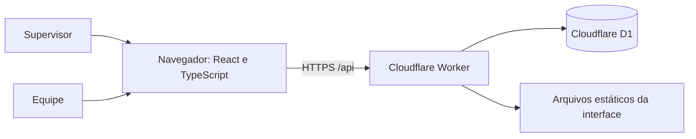

# Documentação do projeto

## Objetivo e escopo

O Controle de Execução de Ordens reúne a carteira mensal importada de planilhas em um lugar. O supervisor acompanha a carteira por responsável, cadastra acessos e consulta o histórico. As equipes veem apenas as ordens vinculadas ao seu perfil e registram execução ou impedimento com protocolo. A interface é responsiva para computador, tablet e celular.

O sistema não edita a planilha original em tempo real. O arquivo é importado para o banco e a exportação gera uma nova planilha de acompanhamento.

## Arquitetura



- `src/App.tsx` implementa as telas, formulários, estados e atualização periódica.
- `src/styles.css` define o layout responsivo.
- `src/lib/excel.ts` lê planilhas `.xlsx`, mapeia colunas e gera arquivos de exportação.
- `src/data/api.ts` centraliza requisições HTTP e cursores de sincronização.
- `worker/index.js` atende a API, valida sessão e autorização, grava ordens e protocolos no D1.
- `worker/access-profile-validation.js` concentra validações dos perfis no servidor.
- `drizzle/*.sql` contém as migrações do banco. `wrangler.jsonc` configura Worker, arquivos da interface e a ligação `DB`.

## Dados e regras de negócio

| Tabela | Finalidade |
| --- | --- |
| `work_orders` | Estado atual de cada ordem e sua revisão de sincronização. |
| `access_profiles` | Tipo, responsável, código, estado e hash da senha dos acessos. |
| `execution_records` | Histórico imutável de tentativas com protocolos. |
| `photos` | Evidências de impedimento, vinculadas ao protocolo. |
| `imports` | Registro das importações. |
| `sessions` | Sessões com validade e token armazenado como hash. |
| `sync_metadata` | Revisões da carteira e das mudanças incrementais. |
| `login_attempts` | Controle de tentativas de autenticação. |

O perfil usa **tipo de empresa + RESPONSÁVEL** para limitar ordens. O servidor aplica esse filtro em consultas, registros de execução e leitura de fotos. Um perfil sem ordens no mês continua válido e recebe uma lista vazia. Dados usados no histórico incluem o nome configurado em **Nome registrado nos protocolos**.

Uma execução muda a ordem para `executada` e cria um registro de auditoria. Um impedimento cria um registro de auditoria, mas deixa a ordem `pendente` para uma nova tentativa. A confirmação e o protocolo são retornados pelo servidor após a gravação; atualizar a interface local sem essa resposta não comprova salvamento. Tentativas concorrentes sobre uma ordem concluída recebem conflito.

## Importação e exportação

Há dois fluxos de importação:

1. **Nova carteira do mês:** importa uma planilha quando não há carteira ativa. Para trocar de mês, o supervisor precisa exportar a carteira completa e confirmar a exclusão da carteira ativa. A exclusão não remove os perfis e o histórico de protocolos.
2. **Acrescentar ordens:** inclui linhas novas durante o mês sem substituir ordens existentes. Linhas duplicadas, incompletas e marcadas **CANCELAR ORDEM** são ignoradas, com contagem mostrada na tela.

A prévia identifica a aba, colunas e linhas elegíveis. Cabeçalhos duplicados impedem a importação. A exportação preserva as colunas de origem e acrescenta quantidade executada, situação, motivo do impedimento, observação, operador, data e protocolo; também inclui resumos por equipe e responsável. O arquivo gerado não preserva a formatação visual exata do original.

## API principal

| Rota | Uso |
| --- | --- |
| `POST /api/login`, `GET /api/session`, `POST /api/logout` | Autenticação e sessão. |
| `GET /api/state` | Carteira completa ou mudanças desde o cursor informado. |
| `POST /api/admin/state` | Alterações administrativas, como importação inicial e perfis. |
| `POST /api/admin/orders/import` | Inclusão de ordens complementares. |
| `POST /api/admin/orders/clear` | Exclusão da carteira ativa após conferência de revisão. |
| `GET /api/admin/executions` | Histórico paginado para o supervisor. |
| `POST /api/executions` | Execução ou impedimento por uma equipe autorizada. |
| `GET /api/photos/:protocol` | Foto de evidência, respeitando o acesso. |

O servidor recusa alterações administrativas feitas por equipes, registros fora do responsável autorizado e requisições `POST` de outra origem. O cookie de sessão é `HttpOnly`, `Secure` e `SameSite=Lax`. Senhas de perfis são derivadas com PBKDF2 SHA-256 e 100.000 iterações; as senhas de texto puro não devem ser adicionadas ao repositório. Os segredos do supervisor são variáveis do Worker.

## Sincronização e consumo do D1

Uma execução grava somente a ordem afetada, a revisão e o registro de auditoria, além da foto se houver. As telas abertas consultam alterações a cada 2 minutos e ao voltar do segundo plano. Com um cursor válido, o servidor devolve somente mudanças e notificações desde a última revisão. Consultas frequentes geram leituras e requisições; gravações e limites diários ou mensais do D1 são métricas diferentes. O plano pago amplia as franquias, mas não corrige falhas de código, validação ou configuração. Acompanhe o uso real no painel Cloudflare.

O modo atual exige conexão. Não há fila local confiável para trabalho offline nem envio automático posterior. A confirmação visual de um protocolo deve ocorrer antes de considerar a ordem registrada.

## Desenvolvimento local

Requer Node.js e npm. Na raiz do projeto:

```bash
npm install
npm run cf:db:migrate:local
npm run dev
```

O Vite serve a interface em desenvolvimento. Para testar o fluxo completo com a API e um banco D1 **local**, execute `npx wrangler dev --local` após preparar as migrações locais e fornecer credenciais de supervisor de teste como variáveis do ambiente local. Não use credenciais reais em scripts ou capturas. Consulte os scripts disponíveis em `package.json`.

```bash
npm test
npm run build
```

O Worker publicado usa o banco apontado por `wrangler.jsonc`. Antes de publicar, confira o identificador do D1, aplique as migrações remotas e configure `SUPERVISOR_CODE` e `SUPERVISOR_PASSWORD` como segredos do Worker. A publicação manual é `npm run deploy`. **Migrações remotas e publicação alteram produção**; revise o destino antes de executá-las. O [README](../README.md) traz o roteiro inicial de instalação e publicação.

## Operação e manutenção

- Faça a troca mensal somente depois de guardar a exportação completa e conferir a quantidade de ordens.
- Use os protocolos e o histórico para auditoria; uma linha de impedimento na carteira atual permanece pendente.
- Revise os perfis após importar outro mês, porque alguns responsáveis podem não aparecer na carteira nova.
- Monitore falhas do Worker e limites de uso do D1. Ao investigar uma falha, use o horário, rota e referência apresentados na tela ou nos logs.
- A foto fica no D1 em base64, limitada a 1,2 MB por envio. Se o volume de imagens crescer, reavaliar o armazenamento de arquivos será uma melhoria de arquitetura.

Para instruções de operação das telas, consulte o [manual do usuário](manual-do-usuario.md).
