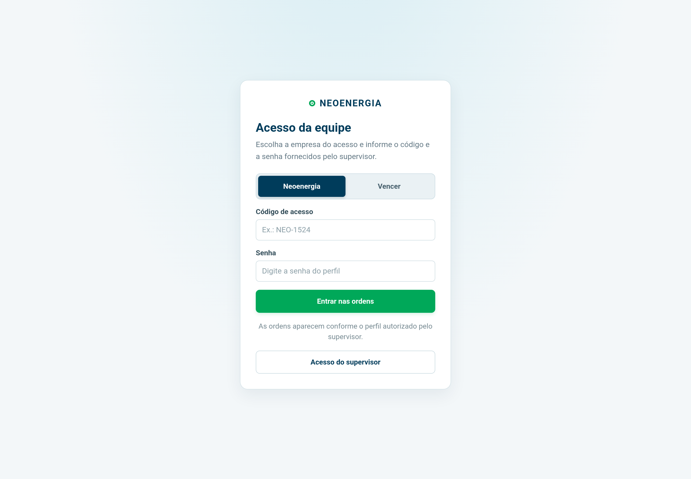
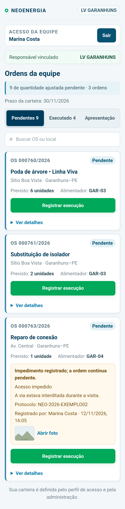
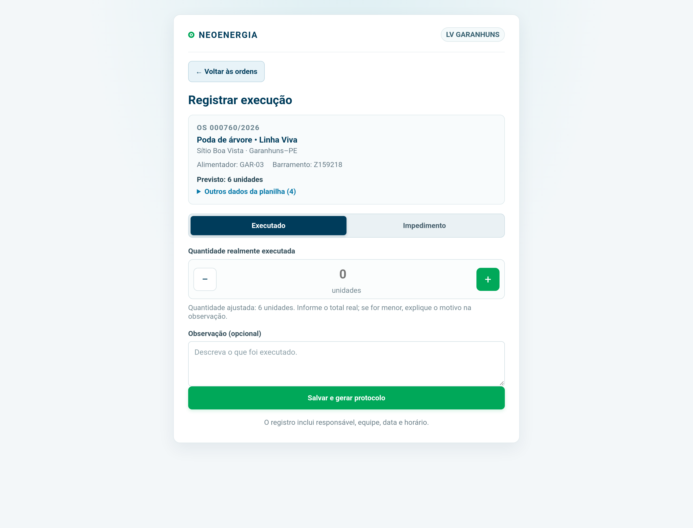
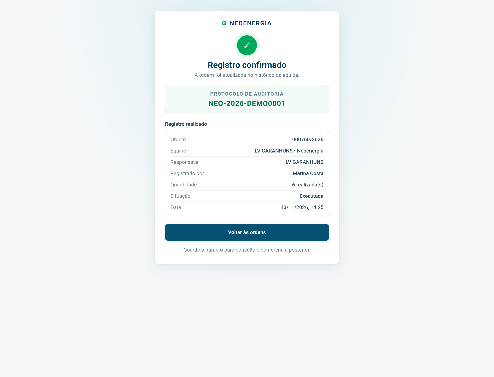
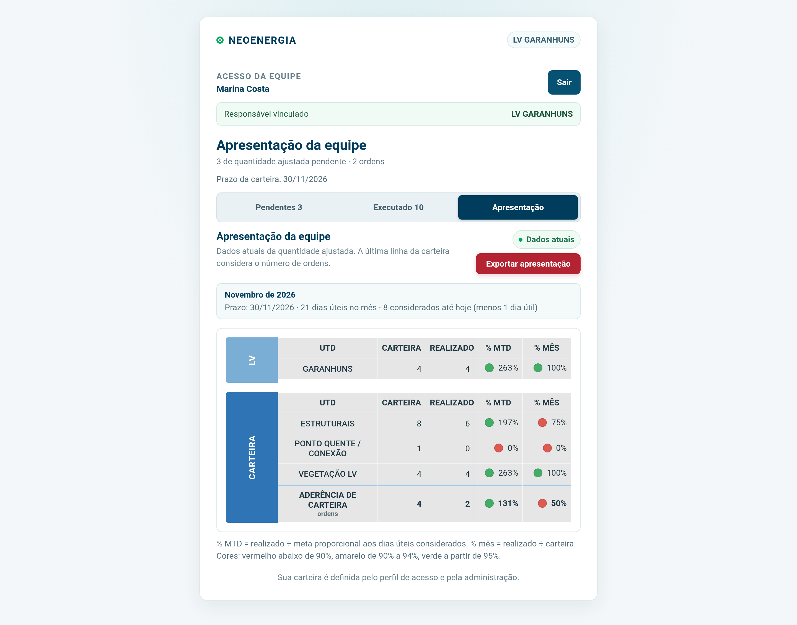
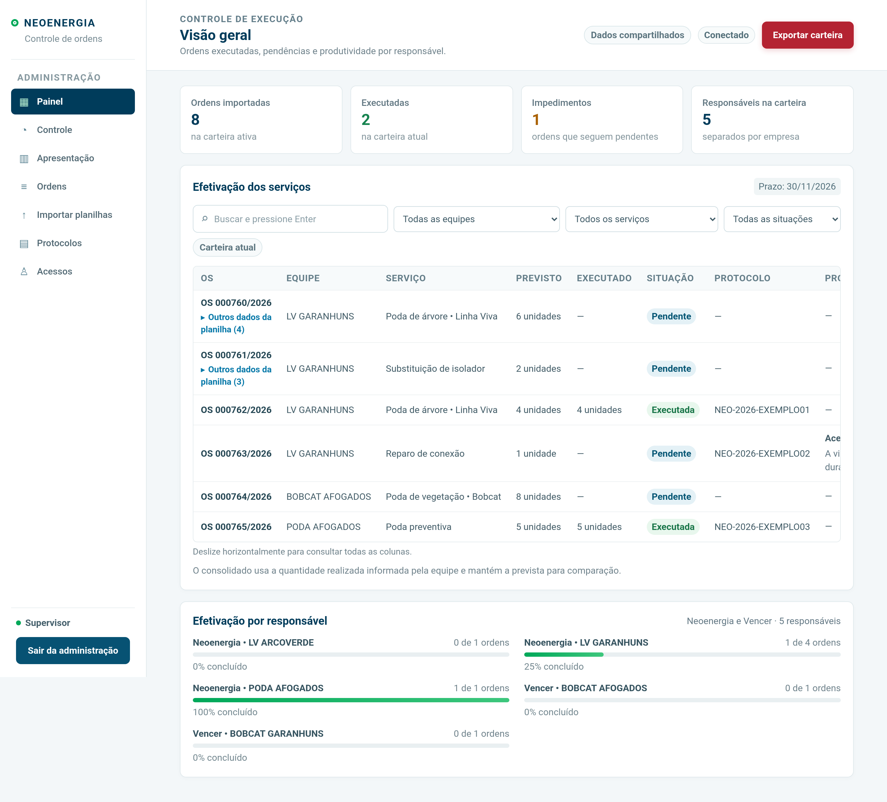
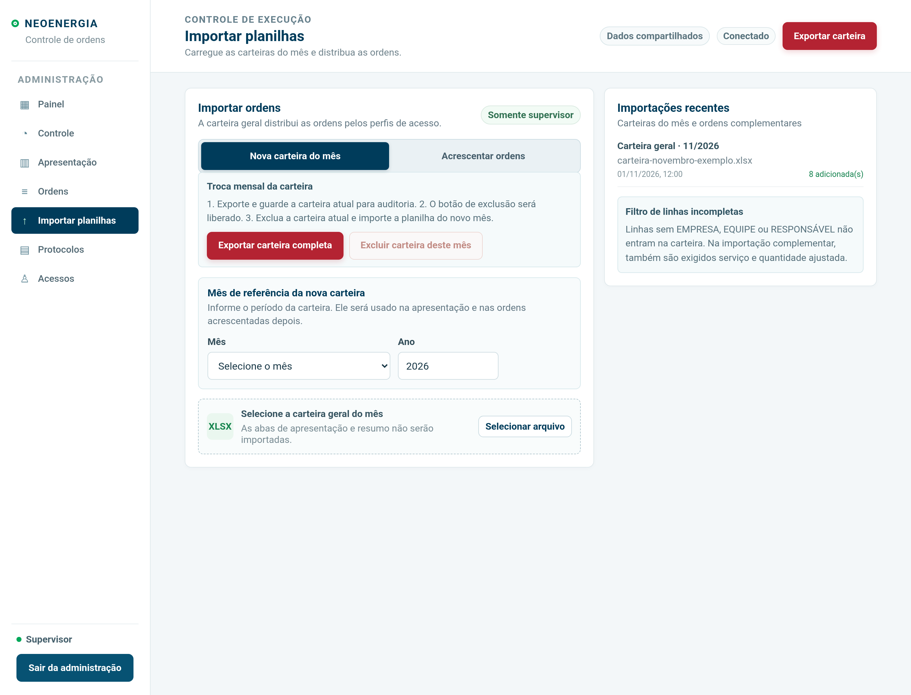
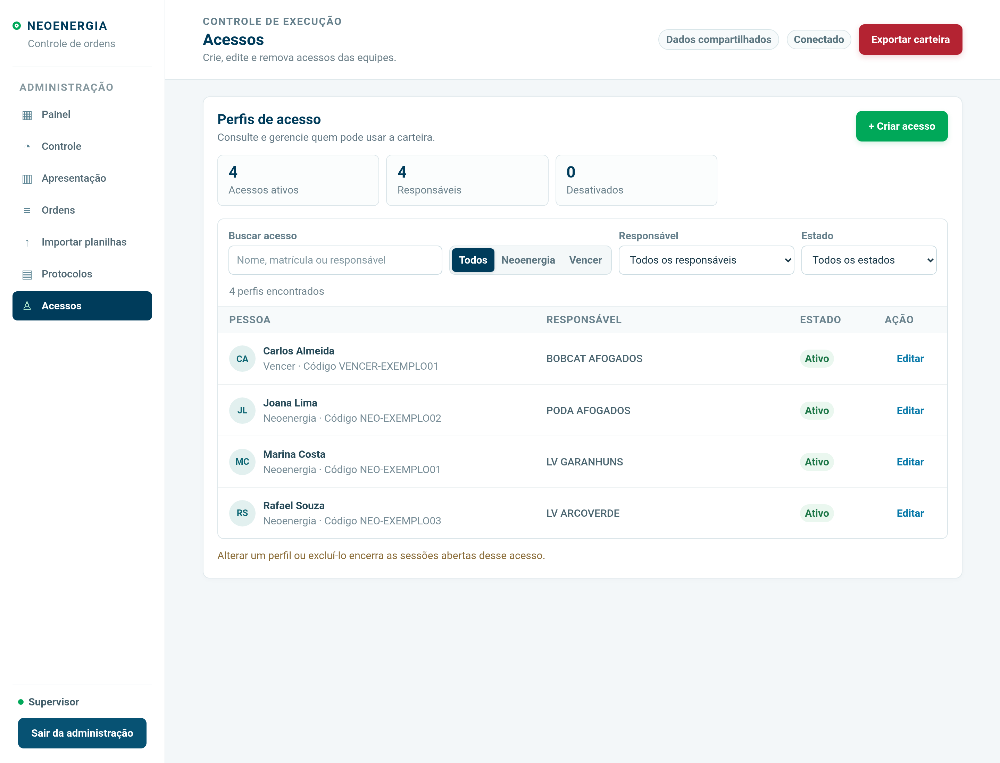
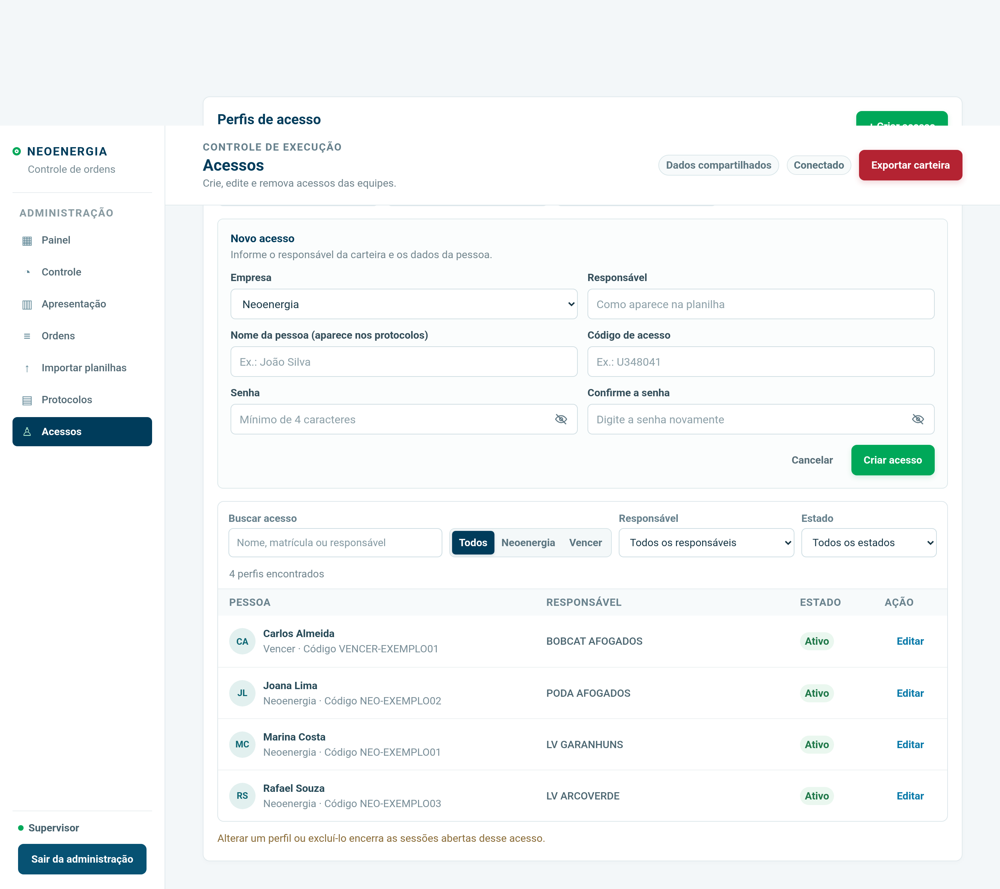
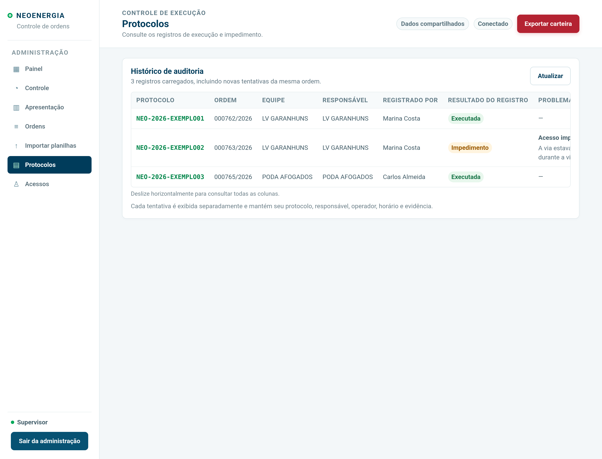

  CONTROLE DE EXECUÇÃO DE ORDENS
  <h1>Manual de uso</h1>
  
Um guia prático para equipes e supervisão, da consulta da carteira à conferência dos protocolos.

  Edição de novembro de 2026 · versão 1.0
  Idealização e desenvolvimento: João Henrique Ferreira

# Neste guia

- [Boas-vindas e o essencial](#boas-vindas)
- [1. Entrar no sistema](#1-entrar-no-sistema)
- [2. Usar a área da equipe](#2-usar-a-área-da-equipe)
- [3. Registrar uma execução](#3-registrar-uma-execução)
- [4. Registrar um impedimento](#4-registrar-um-impedimento)
- [5. Consultar a apresentação](#5-consultar-a-apresentação)
- [6. Navegar na área do supervisor](#6-navegar-na-área-do-supervisor)
- [7. Importar uma carteira do mês](#7-importar-uma-nova-carteira-do-mês)
- [8. Acrescentar ordens](#8-acrescentar-ordens-durante-o-mês)
- [9. Fazer a troca mensal](#9-fazer-a-troca-mensal-com-segurança)
- [10. Criar e manter acessos](#10-criar-e-manter-acessos)
- [11. Conferir protocolos e evidências](#11-conferir-protocolos-e-evidências)
- [12. Salvamento e solução de problemas](#12-salvamento-atualização-e-solução-de-problemas)

# Boas-vindas

O Controle de Execução de Ordens reúne a carteira mensal em um só lugar. As equipes consultam os serviços vinculados ao próprio acesso, registram uma execução ou um impedimento e recebem um protocolo. A supervisão importa as carteiras, acompanha os resultados e confere os registros.

Este guia foi escrito para ser consultado durante o trabalho. Os exemplos e as telas deste documento usam dados demonstrativos fictícios; códigos, nomes e protocolos das imagens não são credenciais nem registros reais.

## O essencial em um minuto

| Se você precisa… | Faça isto |
| --- | --- |
| Entrar como equipe | Escolha Neoenergia ou Vencer, informe seu código e senha e pressione **Enter** ou **Entrar nas ordens**. |
| Registrar uma execução | Abra uma ordem pendente, informe o total realmente executado e salve. Guarde o protocolo confirmado. |
| Informar um impedimento | Escolha **Impedimento**, preencha motivo e observação e, se ajudar a conferência, anexe uma foto. A ordem permanece pendente. |
| Consultar o andamento | Abra **Apresentação**. A carteira atualiza quando o sistema recebe novos registros. |
| Trocar ou complementar a carteira | Entre na área do supervisor e use **Importar planilhas**. A troca mensal exige exportar e excluir a carteira anterior antes de importar a nova. |

## Antes de começar

- Use um navegador atualizado e uma conexão com a internet. O sistema não salva registros para envio posterior quando o aparelho está sem conexão.
- Peça à supervisão o código, a senha e a empresa corretos para o seu acesso.
- Em aparelho compartilhado, saia do sistema ao terminar.
- Considere um registro finalizado apenas depois da confirmação na tela e da emissão do protocolo.

# 1. Entrar no sistema

Na tela inicial, selecione **Neoenergia** ou **Vencer** conforme o seu cadastro. Digite o código e a senha recebidos da supervisão. Pressionar **Enter** em um dos campos também envia o formulário. Selecione **Acesso do supervisor** para abrir o login administrativo.

Se o sistema informar que o perfil não tem atividades na carteira atual, o acesso continua válido. A supervisão deve conferir se o responsável do perfil coincide com a coluna **RESPONSÁVEL** da planilha do mês e se há ordens destinadas a ele.

*Tela demonstrativa: use a empresa, o código e a senha fornecidos para o seu perfil.*

# 2. Usar a área da equipe

Na tela **Ordens da equipe**, você verá a empresa, o responsável vinculado e o prazo da carteira. As abas organizam o trabalho:

- **Pendentes**: ordens que ainda podem receber uma execução ou uma nova tentativa de execução.
- **Executado**: ordens concluídas vinculadas ao perfil.
- **Impedimentos**: permanecem na aba **Pendentes**, porque ainda precisam ser executados; o histórico completo fica em **Protocolos** para a supervisão.
- **Apresentação**: resumo dos resultados da carteira em formato próximo ao da planilha.

Use a busca para localizar uma OS ou um local. Abra **Ver detalhes** para consultar outros campos importados. A quantidade que aparece como prevista vem de **QTD. AJUSTADA**. Ela não é necessariamente o mesmo número que a equipe executa de fato.

No celular, cada ordem aparece em um cartão que ocupa a largura disponível. A busca, o estado e a ação principal ficam juntos para evitar que seja preciso percorrer uma tabela larga.

*Exemplo fictício em formato mobile. O número mostrado na aba Pendentes representa quantidade ajustada; a tela também informa quantas ordens existem.*

# 3. Registrar uma execução

1. Na aba **Pendentes**, localize a ordem e confira OS, serviço, local e quantidade prevista.
2. Toque em **Registrar execução** e mantenha **Executado** selecionado.
3. Ajuste **Quantidade realmente executada** usando os botões de menos e mais.
4. Se a quantidade real for menor que a ajustada, explique a diferença em **Observação**.
5. Toque em **Salvar e gerar protocolo**. Aguarde o retorno do servidor.
6. Guarde o protocolo exibido em **Registro confirmado**.

Depois da confirmação, a ordem sai das pendentes e aparece nos registros concluídos. Se outra equipe concluiu a mesma ordem primeiro, atualize a tela e confira o estado antes de tentar novamente.

*A quantidade executada fica registrada no protocolo. A apresentação da carteira usa a quantidade ajustada das ordens concluídas.*

*O protocolo é a confirmação para consulta posterior. O código na imagem é fictício.*

## Como interpretar as quantidades

Exemplo: uma ordem tem **QTD. AJUSTADA = 6** e a equipe executou **4**. O protocolo guarda **4 realizadas** e a observação explica a diferença. Na apresentação, a ordem concluída contribui com **6** para o total realizado, pois o indicador compara a carteira ajustada com as ordens concluídas.

# 4. Registrar um impedimento

1. Abra a ordem pendente e escolha **Impedimento**.
2. Selecione o motivo e descreva o que aconteceu em **Observação**.
3. Se houver uma evidência útil, escolha **Adicionar foto de constatação**. O aparelho permite tirar uma foto ou escolher uma imagem da galeria.
4. Confira a imagem e toque em **Registrar impedimento**.
5. Aguarde a confirmação e guarde o protocolo.

O impedimento fica disponível para a supervisão consultar, inclusive com a foto enviada. Ele **não conclui a ordem**: ela segue pendente para uma nova tentativa. Cada nova tentativa gera seu próprio registro e protocolo. As imagens aceitas são JPEG, PNG e WebP, limitadas a aproximadamente 1,2 MB por envio.

# 5. Consultar a apresentação

A aba **Apresentação** organiza os resultados por frente de serviço e UTD. Os valores principais são:

| Indicador | O que representa |
| --- | --- |
| **Carteira** | Soma da quantidade ajustada destinada ao grupo. |
| **Realizado** | Soma da quantidade ajustada das ordens concluídas. |
| **% mês** | Realizado dividido pela carteira total. |
| **% MTD** | Realizado comparado à meta proporcional aos dias úteis considerados até a data. |
| **Aderência de carteira** | Ordens concluídas sobre o total de ordens; esta última linha conta ordens, não quantidades. |

Durante o mês, o cálculo de MTD conta os dias úteis até hoje e subtrai um dia útil, conforme a regra definida para a apresentação. Sábados e domingos não contam; feriados não são retirados. No fim do último dia do mês, o prazo da carteira se encerra. A partir do mês seguinte, a meta usa todos os dias úteis do mês e as ordens que permaneceram pendentes são mostradas como **não executadas no prazo**.

O sistema apresenta os valores atuais e oferece **Exportar apresentação** para baixar um Excel com as abas **APRESENTAÇÃO** e **ACOMPANHAMENTO**, seguindo o modelo visual original. Esse arquivo contém somente os dados permitidos ao seu acesso.

*O resumo não usa gráficos para comparar valores de escalas muito diferentes; conserva a leitura tabular do modelo operacional.*

# 6. Navegar na área do supervisor

O menu administrativo reúne as tarefas por assunto. No computador, use a barra lateral. No celular, abra o botão **☰**.

| Página | Uso principal |
| --- | --- |
| **Painel** | Resumo da carteira, execução, impedimentos e avanço por responsável. |
| **Controle** | Indicadores de situação, equipe, serviço e responsável. |
| **Apresentação** | Acompanhamento no padrão definido a partir da planilha. |
| **Ordens** | Busca, filtros, dados importados, estado e evidências. Não há botão de exportação de seleção. |
| **Importar planilhas** | Importação da carteira mensal, inclusão de novas ordens e troca mensal. |
| **Protocolos** | Histórico de execuções e impedimentos, pessoas, horários, observações e fotos. |
| **Acessos** | Criação e manutenção dos perfis das equipes. |

O status **Conectado** mostra que há comunicação com o servidor. Para confirmar uma alteração administrativa, aguarde **Salvo no servidor** ou **Alterações salvas**.

# 7. Importar uma nova carteira do mês

Antes de importar, confira se a planilha está completa e se cada ordem tem número, **EMPRESA**, **EQUIPE** e **RESPONSÁVEL**. Na importação complementar, também são exigidos serviço e quantidade ajustada maior que zero.

1. Abra **Importar planilhas** e escolha **Nova carteira do mês**.
2. Informe o **mês** e o **ano de referência**. O período é registrado a partir desses campos; o nome do arquivo não define o mês da carteira.
3. Selecione a planilha geral. A aba **ACOMPANHAMENTO** é preferida quando contém as colunas da carteira.
4. Leia a **Conferência antes de importar**: veja as linhas aceitas, as linhas incompletas e os cabeçalhos repetidos.
5. Corrija o arquivo se necessário e clique em **Importar carteira do novo mês**.
6. Aguarde a confirmação e confira as quantidades no Painel e em Ordens.

Linhas sem os dados obrigatórios são ignoradas. Linhas que contenham **CANCELAR ORDEM** são descartadas. A apresentação e as abas de resumo não são importadas como ordens.

*A carteira só fica disponível para as equipes depois da confirmação do servidor.*

# 8. Acrescentar ordens durante o mês

Use **Acrescentar ordens** quando receber novas ordens sem substituir a carteira ativa.

1. Abra **Importar planilhas** e escolha **Acrescentar ordens**.
2. Selecione a planilha das novas ordens e confira a prévia.
3. Confirme que cada linha tem número da OS, empresa, equipe, responsável, serviço e quantidade ajustada positiva.
4. Clique em **Acrescentar à carteira atual** e confira o resumo da importação.

As ordens existentes e seus protocolos ficam preservados. As ordens novas herdam mês e ano da carteira ativa. O sistema reconhece duplicatas pela combinação **número da ordem + empresa + responsável** e mostra quantas foram incluídas, duplicadas ou ignoradas.

# 9. Fazer a troca mensal com segurança

O sistema libera a exclusão da carteira atual depois que a exportação completa é concluída. O arquivo inclui as colunas disponíveis da planilha, os campos de execução e auditoria e as abas de resumo. Ele usa a paleta de cores, as fontes, as bordas e o padrão de cabeçalho do modelo de apresentação. Faça a troca a partir do primeiro dia do novo mês, quando a carteira anterior já terminou.

1. Em **Importar planilhas > Nova carteira do mês**, clique em **Exportar carteira completa** e guarde o arquivo baixado.
2. Confira se o arquivo contém a quantidade esperada de ordens.
3. Clique em **Excluir carteira deste mês** e confirme. A aplicação verifica se a carteira não mudou após a exportação; se mudou, exporte novamente.
4. Informe mês e ano da nova carteira, selecione a planilha e importe.
5. Confira a carteira nova e os responsáveis vinculados aos perfis.

A exclusão da carteira ativa não apaga os perfis nem o histórico de protocolos. O arquivo completo é destinado à auditoria das ordens e contém campos de execução. Ele mantém os dados e resumos da carteira com a identidade visual do modelo. **Exportar apresentação** continua sendo uma opção separada, com apenas as abas de apresentação e acompanhamento no layout original.

# 10. Criar e manter acessos

Crie apenas os perfis necessários ao trabalho da carteira. Um perfil ativo sem ordens vinculadas continuará mostrando **Sem atividades na carteira atual** até que uma carteira contenha ordens para aquele responsável.

1. Abra **Acessos** e selecione **+ Criar acesso**.
2. Escolha a empresa e informe o **Responsável** exatamente como está escrito na carteira.
3. Preencha o nome da pessoa, o código de acesso, a senha e a confirmação.
4. Use o ícone de olho para conferir a senha digitada. O código deve ser único; a senha deve ter ao menos quatro caracteres.
5. Clique em **Criar acesso** e aguarde a mensagem **Alterações salvas** antes de entregar as credenciais.

Se o sistema mostrar um aviso de que não existem ordens para o responsável, revise a grafia e confirme se a pessoa realmente usará esta carteira. A senha não pode ser consultada depois que o perfil é salvo; entregue-a por um canal apropriado e oriente a equipe a solicitar a troca quando necessário.

Para editar um perfil, use a busca por nome, matrícula ou responsável e clique em **Editar acesso**. Campos de senha vazios mantêm a senha atual. O perfil pode ser ativado, desativado ou excluído. A exclusão é permanente e encerra as sessões do perfil; os protocolos históricos permanecem.

# 11. Conferir protocolos e evidências

Em **Protocolos**, o supervisor encontra cada tentativa separadamente. Confira o número da OS, o protocolo, a equipe, o responsável, quem registrou, a situação, a observação, a data e a evidência. **Abrir foto** exibe a imagem associada ao impedimento. Use **Atualizar** para recarregar e **Carregar mais registros** para consultar páginas anteriores.

Na página **Ordens**, os filtros ajudam a localizar pendências, execuções e impedimentos. Para consultar todos os campos de uma ordem, use **Outros dados da planilha**. Tabelas largas podem pedir rolagem horizontal, principalmente em telas menores.

# 12. Salvamento, atualização e solução de problemas

Os registros confirmados ficam no servidor. As telas abertas recebem avisos de mudanças e atualizam os dados; também há atualização periódica e ao retornar a uma aba do navegador. A atualização periódica consulta o estado, mas não regrava toda a carteira. A equipe também pode atualizar o navegador manualmente.

| Mensagem ou situação | Próximo passo |
| --- | --- |
| **Sem atividades na carteira atual** | Peça à supervisão para conferir empresa, responsável e carteira do mês. |
| **Falha ao salvar** ou perfil rejeitado | Leia a mensagem completa, confira os campos e tente novamente. Não distribua o acesso antes da confirmação. |
| **Falha ao gerar protocolo** | Anote OS, horário e referência do erro. Antes de repetir, peça para conferirem a tela Protocolos, para evitar duplicar uma tentativa que tenha sido registrada. |
| A ordem já foi concluída | Atualize a lista e confira a aba **Executado**. |
| Foto recusada | Escolha JPEG, PNG ou WebP de até aproximadamente 1,2 MB. |
| A carteira mensal não entra | Confirme mês e ano, aba reconhecida, colunas obrigatórias e prévia de linhas ignoradas. |
| A tela parece desatualizada após publicação | Recarregue o navegador. Uma página aberta pode continuar com a versão anterior até ser recarregada. |

Ao relatar um problema, informe a tela, o número da ordem, o horário aproximado e a mensagem mostrada. Nunca envie senhas em uma captura ou mensagem de suporte.

## Vocabulário rápido

- **Carteira:** conjunto de ordens do período ativo.
- **Quantidade ajustada:** quantidade de referência registrada na planilha.
- **Quantidade realmente executada:** quantidade declarada pela equipe no registro.
- **Impedimento:** registro de uma tentativa que não concluiu a ordem.
- **Protocolo:** código que identifica uma execução ou tentativa registrada.
- **Responsável:** campo da carteira usado para vincular as ordens ao perfil.
- **UTD:** unidade operacional usada para agrupar os resultados da apresentação.

---

**Documentação complementar:** consulte a [documentação técnica e de operação](documentacao-do-projeto.md) para conhecer arquitetura, dados, limites e publicação do sistema.
